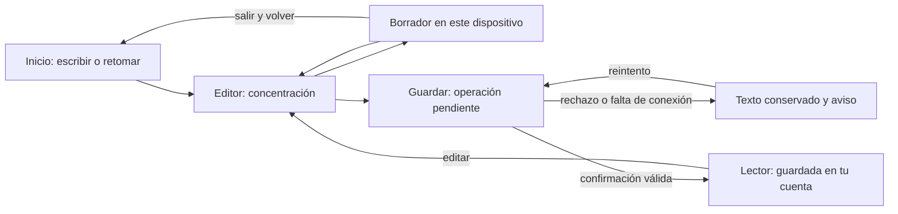
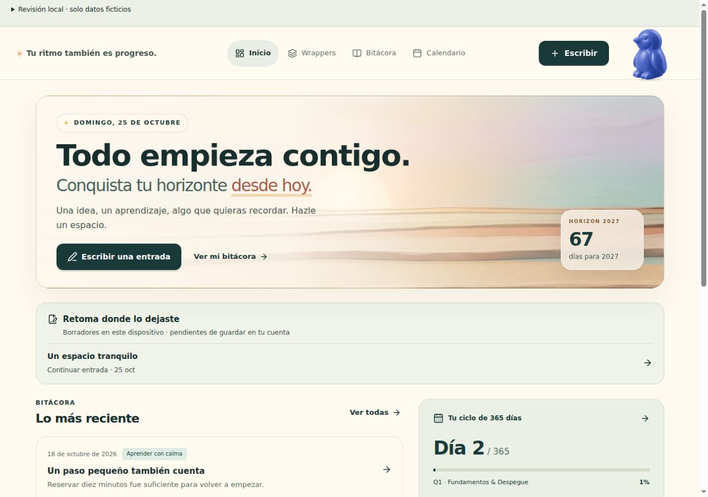
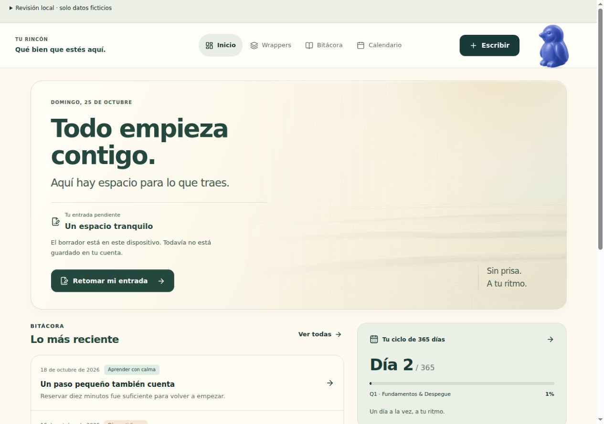
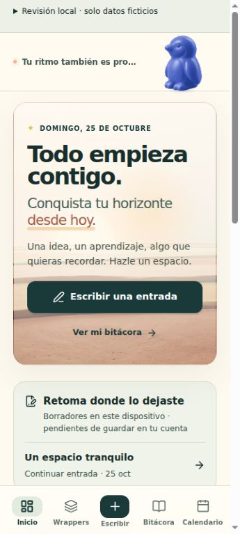
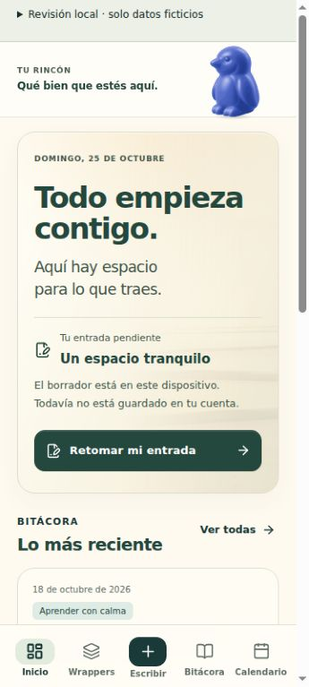

# Horizon: presencia y concentración

Rama: `codex/companion-presence-ux`. Base: `25d547b` (v0.1.11). Evaluación: 24–25 de octubre de 2026. La evaluación original se realizó localmente, sin publicación. El usuario autorizó posteriormente distribuirla como v0.1.12; véanse las [notas de la release](releases/v0.1.12.md).

## Objetivo y alcance

Que Horizon parezca disponible y atento, dejando espacio para pensar. La compañía es una hipótesis perceptiva que requiere observación con personas; la corrección de estados sí puede comprobarse mediante pruebas. Se conservan ilustraciones originales, «Todo empieza contigo», wrappers, entradas y cuenta. Sin chat, inferencias sobre el diario, nuevos servicios ni incentivos de uso.

## Aceptación definida antes de implementar

1. Llegada: una invitación principal según contexto (retomar borrador local, escribir o preparar primer wrapper); ninguna bienvenida repetida al cambiar de sección. No insinuar que el borrador está sincronizado.
2. Concentración: editor, campo enfocado y teclado suprimen saludo, paseos y aletas. El compañero conserva posición y área táctil. La retirada se completa en 650 ms; no se acumulan gestos mientras está oculto, pausado o con movimiento reducido.
3. Guardado: solo `await onSave` resuelto y cuenta vigente puede generar reconocimiento. Cero gestos de éxito para borrador local, pendiente, fallo, sesión caducada o sin conexión. Un asentimiento de hasta 1,2 s por confirmación, con enfriamiento de 8 s; error y concentración tienen prioridad.
4. Escritura: conservar guardado local de 500 ms, recuperación tras salir/volver y protección ante errores. Ningún retraso artificial de guardado o navegación para completar una animación.
5. Accesibilidad: controles principales de 48 px, sin desbordamiento horizontal a 320 y 360 px, navegación por teclado y sin nuevas infracciones axe A/AA. Movimiento reducido y pausa efectivos; toda información existe como texto independiente del animal.
6. Rendimiento: comparaciones en el mismo navegador/dispositivo y tramo estable de 20 s. p95 del intervalo entre frames no mayor que base +8 ms; proxy entrada→siguiente RAF no mayor que base +16,7 ms, con al menos 20 eventos por tramo; ninguna tarea nueva de 100 ms atribuible a presencia. Estas métricas del scheduler no equivalen a INP ni a presentación física. El compositor no lee texto ni actualiza React por pulsación o frame. Máximo 24 dibujos/s del animal; cero bucle activo al suspenderlo.
7. Veracidad: las pruebas con dobles, tamaños de viewport y clase de teclado son simulaciones. Android real solo se acredita con dispositivo; sin participantes no se declarará demostrada la mejora emocional.

## Diagnóstico inicial del código (antes de observar la aplicación)

| Problema | Consecuencia hipotética | Evidencia / confianza | Cambio mínimo |
| --- | --- | --- | --- |
| Navbar rota lemas cada 18 s y el animal conoce solo editor y hover/foco | La vida parece independiente de la intención del usuario | Navbar y AnimalCompanion; implementación comprobada, efecto perceptivo por validar | Mensaje estable y gramática común por contexto |
| Quiet conserva 60% de amplitud y aún permite paseo/aleta | Movimiento secundario durante concentración | penguinMotion; alta sobre comportamiento de código | Quiet con respiración/parpadeo y retirada continua |
| Hero invita a crear aun cuando puede existir borrador | Volver a empezar pesa más que continuar | Dashboard y PendingDrafts; alta sobre orden | CTA contextual que reutiliza recuperación existente |
| Borrador local y cuenta comparten señales de éxito | Posible confusión de protección local con sincronización | Editor y confirmación App; hipótesis de comprensión | Dispositivo para local; reconocimiento solo de confirmación remota |

## Tres intervenciones

1. **Llegada disponible:** bienvenida estable, hero editorial cálido y una acción clara. Conserva el animal sin contenedor y su esquina; gesto inicial breve, variación discrecional cada 8–14 s. Priorizar continuidad cuando hay borrador.
2. **Espacio de concentración:** navbar y superficie editorial se recogen; respiración y parpadeo sin gestos expansivos. Sin mover botones ni depender de hover. Sin tocar el mecanismo que protege el texto.
3. **Cierre verdadero:** texto de cuenta confirmado con jerarquía clara y un pequeño asentimiento. Error > guardando > concentración > reconocimiento > bienvenida > disponible. Sin confeti, sonido o gestos diferidos.

## Método y evidencia

Revisar con propietario sintético aislado, mismos contenidos y tamaños. Guardar capturas originales antes de cambios. Recorrer llegada → nueva entrada → borrador local → guardado → lector, y salida → reanudación → error → reintento. Comparar base y revisión con un selector de laboratorio; los componentes mantienen una vía base sin las nuevas señales. Medir frames y entradas sin capturar texto.

### Línea base observada

Observación directa con `scripts/presence-preview.mjs` (cliente Supabase deshabilitado), escritorio 1280×900 y móvil 360×800: hero con lema conservado, segundo imperativo y botón «Escribir una entrada»; navbar trunca algunos lemas largos en escritorio. El editor conserva foco y comunica borrador local tras la entrada. El guardado simulado pasa por «Guardando en tu cuenta…» y abre lector con «Entrada guardada en tu cuenta». El animal mantiene su rutina independiente. El ensayo emplea 250 ms de respuesta ficticia; no acredita red ni almacenamiento remotos.

La base visual se conserva en el selector «Base» del laboratorio. Las capturas comparables incluidas abajo muestran el mismo propietario ficticio, las mismas entradas y el mismo borrador pendiente. Los tamaños indicados son viewports CSS; el navegador puede reescalar las capturas. La percepción de presión o de acompañamiento no se ha medido con participantes.

## Diagnóstico priorizado y decisiones trazables

| Evidencia reproducible | Tipo, gravedad y confianza | Consecuencia y decisión |
| --- | --- | --- |
| En Base, con un borrador local, el hero sigue proponiendo «Escribir una entrada» y coloca la recuperación debajo. A 360 px hay que avanzar más en la página para verla. | Observado directamente. Interacción, alta cuando hay borrador; frecuencia poblacional desconocida. Alta confianza en el orden, no en su efecto emocional. | La acción principal debe representar continuidad. **Intervención 1:** título del borrador, explicación local/cuenta y «Retomar mi entrada» en el hero; los demás borradores siguen disponibles una sola vez. |
| La navbar cambia de lema cada 18 s; algunos textos se truncan en escritorio. El animal recibe editor/atención, sin señal de operación confirmada. | Truncamiento observado; temporizador y señales comprobados en código. Presentación, media; repetición potencial por temporizador, no frecuencia de molestia medida. | **Intervenciones 1–2:** texto estable según contexto; el personaje y las palabras comparten un estado, sin rotación que compita con la tarea. |
| El motor anterior conserva movimiento amplio con `quiet`; local y guardado usan un check similar. | Movimiento y símbolos inferidos del código y cotejados en la aplicación. Media; ocurre en edición/borrador. Confusión sobre sincronización: hipótesis. | **Intervenciones 2–3:** respiración/parpadeo durante escritura; icono de dispositivo para borrador; asentimiento únicamente tras confirmación remota. Se mantiene el texto explícito de estado. |
| Un bloque Markdown ancho, a 320 px, provoca `scrollable-region-focusable` en axe y no tiene parada de teclado. | Observado directamente con contenido sintético largo. Accesibilidad, alta para quien usa teclado. Confianza alta; condicionado a contenido desbordado. | **Intervención 2:** solo tablas y bloques de código que desbordan reciben foco visible. Se conserva su semántica y sanitización. Se evita volver a insertar el HTML cuando el contenido no cambia. |

Se mantienen la navegación conocida, la selección de wrapper, el formato Markdown, vista previa, búsqueda, lector, recuperación y cuenta. No se agrega un panel del compañero, un diálogo ni una nueva decisión antes de escribir. Se retira el gran contador del hero; el ciclo sigue accesible en su sección. El espacio antes ocupado por él ayuda a que continuidad y escritura dominen la llegada.

## Gramática de presencia implementada

| Estado e intención | Activación real | Expresión y duración | Repetición y salida |
| --- | --- | --- | --- |
| Bienvenida: «este espacio está disponible» | Montaje de la sesión en Inicio, no cada navegación | Inclinación y mirada pequeñas; gesto de 2,1 s dentro de una señal de 2,6 s. «Qué bien que estés aquí». | Una vez por montaje; protección adicional de 90 s en el motor. Salir de Inicio cancela la bienvenida. No se recupera después de escribir. |
| Disponibilidad: «puedes acercarte cuando quieras» | No hay escritura, operación ni señal prioritaria | Respiración, parpadeo, mirada o reajuste muy pequeños de 1,85–2,5 s; sin pasos ni aleteo. | Descansos de 8–14 s entre gestos según animal. Atención al enfocar/acercarse al perfil: una mirada con enfriamiento de 12 s; nunca inicia conversación. |
| Retirada: «tienes espacio para pensar» | Editor activo, campo de texto enfocado, composición, entrada reciente o clase de teclado | Desvanece el gesto actual en 480 ms; después solo respiración y parpadeo. «A tu ritmo. Sin prisa». | Mientras dure el contexto. La entrada reciente conserva quietud 1,8 s; no afecta al guardado ni retrasa navegación. |
| Pendiente: «la operación todavía no terminó» | El editor entra en `await onSave` | Quietud; «Guardando en tu cuenta…». Los estados y controles existentes siguen expresando la operación. | Hasta resolución o rechazo; sin éxito anticipado, sin animación de progreso inventada. |
| Reconocimiento: «se confirmó el guardado» | `onSaved` tras la resolución de `onSave`, con las comprobaciones vigentes de identidad y sesión | Un asentimiento de hasta 1,2 s, sin celebración; señal contextual durante 4,2 s. Confirmación textual persistente y cerrable en lector. | Una vez por contador nuevo; enfriamiento de 8 s. Duplicados, montajes y navegación ordinaria no lo repiten. No se retrasa la apertura del lector. |
| Error: «conserva tu escritura y comprueba el estado» | Error del editor o fallo de protección local | Quietud y texto factual. El aviso específico/reintento sigue en el editor; ningún gesto de preocupación o aprobación. | Hasta que cambie el estado real o se abandone el editor con su protección habitual. |

Prioridad común: **error → guardando → concentración → reconocimiento → bienvenida → disponibilidad**. Escritura/teclado/foco también suprimen el reconocimiento aunque llegue una confirmación válida. Los eventos suprimidos se consumen: no hay cola para mostrarlos cuando el usuario termine. Durante lectura solo quedan los gestos pequeños de disponibilidad; el título y la información de lectura no cambian por temporizadores.

Pausa: conserva la pose, cancela el bucle y mantiene todas las palabras y controles. Movimiento reducido: pose neutral, sin gestos. Pestaña oculta o interfaz inerte por un modal: suspende el bucle. Un redimensionado puede dibujar una vez sin mantener animación. Al volver no se reproducen sucesos anteriores. La cuenta sigue teniendo una preferencia accesible de movimiento en este dispositivo.

### Personalidad sin cambiar el significado

| Animal original | Respiración aproximada | Descanso entre gestos | Matiz |
| --- | --- | --- | --- |
| Nutria | 4,65 s | 8–12 s | Mirada algo más frecuente |
| Yak | 5,5 s | 11–14 s | Menor amplitud y ritmo más reposado |
| Pterodáctilo | 4,5 s | 8–12,6 s | Ligera curiosidad adicional |
| Oso | 5,25 s | 10–14 s | Intermedio y pausado |
| Pingüino | 4,9 s | 9–13 s | Equilibrado y contenido |

Estas son decisiones de animación, no atributos inferidos del usuario. Todos comparten las prioridades, los tiempos de retirada y el significado de confirmación. Se reutilizan las ilustraciones y el articulador existentes, con objetivo táctil estable en la esquina superior derecha. No se incorporó ninguna biblioteca.

## Composición y lenguaje

Solo se añaden tres recursos: papel cálido, tinta verde y movimiento corporal pequeño. El hero conserva «Todo empieza contigo» y la imagen original como textura tenue. «Aquí hay espacio para lo que traes» sustituye el segundo imperativo. El borde, el espacio y la jerarquía separan invitación, borrador y acción sin multiplicar tarjetas.

La navbar usa un rótulo discreto («Tu rincón» / «Espacio para pensar») y una frase contextual estable. Es decoración redundante para tecnologías de asistencia; la información operativa permanece en los avisos accesibles del editor y lector. No se usa el personaje como único portador de información. Los controles de escribir, modo, volver y guardar conservan su lugar y un mínimo de 48 px.

La textura se redujo al 8% y se oscurecieron los textos después de detectar un margen de contraste insuficiente. Cálculo conservador: extremo más oscuro del degradado + máximo del halo + una imagen completamente negra al 8%. Los contrastes mínimos resultantes son 6,67:1 para tinta, 4,89:1 para cuerpo y 4,64:1 para texto secundario. Sobre papel, 10,09:1, 7,40:1 y 7,03:1, respectivamente. Es una comprobación de esos colores y capas, no una certificación WCAG del producto entero.

## Recorridos y estados: antes / después

| Momento | Base | Revisión |
| --- | --- | --- |
| Llegar sin cuenta escrita | Hero con dos lemas y varias salidas; crear primer wrapper | Una invitación; crear primer wrapper → editor. Sin nueva configuración previa. |
| Volver con borrador | Escribir en hero → localizar bloque de borradores → continuar | Borrador y límite local explícitos → «Retomar mi entrada» → texto restaurado. Otros borradores no se duplican. |
| Concentrarse | Quiet reduce amplitud, pero conserva rutina; lema rota | Entrada al editor retira el gesto → respiración/parpadeo; frase estable, superficie de papel y controles sin saltos. |
| Guardar e interrumpir | Texto de estado ya protege la escritura; personaje independiente | Mismo mecanismo de protección + señales coordinadas. Pendiente no asiente; rechazo conserva texto y ofrece reintento; confirmación abre lector inmediatamente. |
| Buscar, leer y editar | Búsqueda → entrada → editar → guardar | Se conserva el recorrido; contexto de lectura discreto, retirada al editar y confirmación al volver al lector. Código/tabla ancho se desplaza también con teclado. |

El borrador local nunca dispara el reconocimiento. Un contador efímero cambia junto con la navegación tras `onSaved`; el contexto recibe únicamente superficie, estado y contador. No recibe texto, títulos, etiquetas, identificadores personales ni correo. Cambiar de cuenta reinicia el contexto. Los guardados locales de 500 ms, `flush`, protección de salida, validación de identidad y `markCommitted` siguen en sus mecanismos originales.

### Comparación visual con el mismo contenido

| Base | Revisión |
| --- | --- |
|  |  |
|  |  |

## Prototipo reproducible

En la raíz del repositorio: `node scripts/presence-preview.mjs`. Abrir `http://127.0.0.1:5190/ux-preview.html?view=dashboard&character=penguin`. El servidor especial sustituye el cliente Supabase por `null`; no crea ni lee una sesión. Usar este servidor para capturas y ensayos. Los borradores tienen propietario ficticio separado; no se utilizan credenciales ni contenido personal.

Abrir «Revisión local · solo datos ficticios» para alternar Base/Revisión, cuenta con entradas, vacía o entrada larga. Los borradores de revisión sobreviven a recargar para probar interrupciones; si existe uno, la llegada lo prioriza incluso al cambiar el escenario. Para ensayar una cuenta completamente nueva, usar un perfil de navegador limpio en este servidor. Las entradas de muestra y los cambios remotos simulados se reinician al recargar.

Recorrido mínimo: escribir → esperar «Borrador en este dispositivo» → Inicio → retomar → seleccionar error → guardar → comprobar texto/ausencia de confirmación → elegir lento → reintentar → observar pendiente → lector confirmado → editar. Probar después desconexión, cuota local y sesión caducada. Desactivar el fallo de cuota y pulsar «Reintentar borrador» antes de abandonar esa prueba.

Los controles de teclado, barras 24/48 px, conexión y cuota son simulaciones explícitas. La desconexión modifica solo el indicador del navegador, no intercepta peticiones ni recursos. Los errores de guardado son dobles de prueba; no acreditan un viaje real hasta Supabase. Las páginas, el cliente ficticio, axe y las métricas quedan fuera de producción.

## Validación realizada

| Comprobación | Resultado y alcance |
| --- | --- |
| Cuenta vacía → primer wrapper → editor | Pasa en navegador con datos ficticios; nombre y wrapper seleccionados en el editor. |
| Salir → recargar → Inicio → retomar | Pasa; se recuperan título y 76 caracteres sintéticos después de la prueba de cuota y su reintento. |
| Error y reintento lento de 3,5 s | Pasa; estado `error`/`saving`, contador falso y texto conservado. Solo la resolución da `saved` y confirmación en lector. |
| Sin conexión, sesión caducada y cuota local llena | Pasa la revisión con dobles; sin éxito ficticio, texto intacto. Cuota informa «Borrador sin proteger» y reintentar vuelve a protección local. No se fuerza una salida que descarte el texto. |
| Buscar «tarde» → leer → editar con Enter → guardar con Enter | Pasa; vuelve al lector con confirmación. No constituye una prueba completa con lector de pantalla. |
| Cinco animales elegibles | Pasa; selección, identificador, póster original y renderizador articulado coinciden en los cinco. Límites y prioridades de todos cubiertos por pruebas del motor. |
| Pausa | Pasa; contador de dibujos permanece 744→744 entre observaciones separadas; estado `paused`. Reactivar vuelve a reproducción, sin cola de gestos. |
| 1280×900, 360×800, 320×720 y 800×360 | Sin desbordamiento horizontal observado en los estados revisados. En móvil, guardar y modos miden 48 px de alto. |
| Texto largo, enlace sin espacios, tabla y código ancho | Pasa lectura/edición con unos 16.000 caracteres. El scroll horizontal queda en el bloque; ArrowRight desplaza código (0→37 px) y el foco se conserva tras actualizar el laboratorio. |
| Viewport reducido 360×420 + clase de teclado + barras 24/48 | Pasa la simulación: sin overflow, compañero quieto y guardar de 48 px dentro del viewport. [Captura](evidence/companion-presence/revised-keyboard-shrink.jpg). Pendiente teclado físico Android. |
| Axe A/AA: Inicio, editor y lector largo | Sin infracciones finales en las vistas ensayadas. Editor: también cero comprobaciones incompletas. Inicio: contraste sobre pseudo-elementos requiere revisión manual, cubierta para los colores nuevos por el cálculo conservador. Lector móvil: queda contraste de etiquetas sobre superficie solapada para inspección física/manual. Un control de cierre con glifo también produjo una comprobación de nombre pendiente en el ensayo de confirmación. No se declara conformidad completa. |
| Unitarias y regresión | 9 archivos pasan; incluyen 11 casos nuevos de motor y 8 de contexto: prioridades, duplicados, caducidad, frecuencia, interrupción continua, suspensión y privacidad de señales. |
| Build web, lint y frontera de producción | Pasan. Lint mantiene 7 avisos preexistentes y cero errores. Sin nuevas dependencias ni cambios de versión. |
| Android debug | Compilación local correcta con Java 21; assets web empaquetados y vistas de revisión excluidas. Sin dispositivo/emulador disponible: no acredita tacto, IME, barras de un fabricante ni consumo real. |

### Rendimiento comparado

Mismo navegador local, 360×800, editor, texto y secuencia de escritura; una ventana completa de 20 s por presentación con 42 eventos de entrada. Se descartó el tramo que coincidía con compilación Android y se midió de nuevo sin esa carga. No se capturan valores de los campos. [Datos base](evidence/companion-presence/performance-baseline.json) y [datos revisión](evidence/companion-presence/performance-revised.json).

| Métrica / umbral previo | Base | Revisión | Evaluación |
| --- | --- | --- | --- |
| Intervalo RAF p95; revisión ≤ base +8 ms | 33,3 ms | 33,3 ms | Pasa en este ensayo |
| Entrada → siguiente RAF p95; revisión ≤ base +16,7 ms | 11,7 ms | 11,5 ms | Pasa en este ensayo; diferencia no significativa acreditada |
| Tareas ≥100 ms nuevas | 0 | 0 | Ninguna observada |
| Tareas largas / máxima | 1 / 53 ms | 0 / 0 ms | No permite atribuir una mejora general |

Son proxies del scheduler en un entorno de escritorio, una muestra por variante y sin garantía de refresco físico. No son INP, estudio de batería ni benchmark Android. El límite de 24 dibujos/s y la cancelación del bucle se comprueban además en el adaptador del motor. El ajuste final de contraste y foco de bloques no cambió esa coreografía; no se repitió el benchmark después de esos ajustes.

### Fallos encontrados y resueltos durante la revisión

- La textura al 22% dejaba márgenes insuficientes de contraste: se redujo al 8% y se oscureció el texto.
- Código ancho sin foco produjo una infracción seria de axe: se añadió foco condicional y contorno; la repetición final no presenta esa infracción.
- El renderizado de HTML podía reinsertar bloques durante actualizaciones ajenas a su contenido y perder el atributo de foco. Se estabilizó `MarkdownRenderer` y la medición se aplica al confirmar su DOM. Se comprobó después de actualizar el laboratorio.
- Una actualización en caliente al cambiar el tipo del componente interrumpió la vista de desarrollo. Una recarga limpia y la repetición de lectura/teclado/auditoría pasan; no se ha observado ese fallo en una carga limpia.

## Qué conservar, corregir o descartar con participantes

No hubo participantes disponibles. «Se siente acompañado», «parece ilusionado» y «distrae menos» siguen siendo hipótesis. La ausencia de errores en el recorrido interno no demuestra esas percepciones.

Siguiente prueba pequeña: 5 participantes, comparación contrabalanceada Base/Revisión con tareas y datos ficticios. Sin describir de antemano la intención del animal. Registrar finalización, vacilaciones, desvíos, ayuda solicitada y miradas/interrupciones hacia el personaje. Preguntas neutrales: «¿Qué acaba de ocurrir?», «¿Dónde está guardado ahora?», «¿Qué te llamó la atención mientras escribías?» y, al terminar, «¿Cómo describirías la presencia del personaje?».

Reglas de decisión definidas para esa prueba: corregir inmediatamente si una persona interpreta un borrador o fallo como guardado remoto, o pierde escritura. Conservar provisionalmente la continuidad si al menos 4/5 encuentran el borrador sin ayuda. Conservar la animación solo si no impide completar tareas, como máximo 1/5 la identifica espontáneamente como distractora y al menos 3/5 describen disponibilidad o compañía sin sugerírselo. Si las palabras y jerarquía funcionan pero la animación distrae, retirar primero la variación discrecional y repetir; si el reconocimiento confunde, mantener solo confirmación textual. Son puertas cualitativas de una prueba pequeña, no estimaciones poblacionales ni métricas de retención.

## Secuencia y entrega técnica

1. **Base y contrato:** aislar datos, fijar aceptación y documentar señales existentes. Dependencia: aplicación funcional; sin modificar backend.
2. **Recorrido vertical con pingüino:** conectar llegada → editor → confirmación como una transición semántica. Riesgo principal: emitir éxito antes de guardar o después de cambiar de cuenta; cubierto por guardas existentes, contador efímero y pruebas temporales.
3. **Reglas comunes:** extender al mismo articulador de los cinco animales y recomponer hero, navbar y superficie de escritura. Dependencia: recorrido vertical correcto. Riesgo: ruido o pérdida de identidad; se conservan assets y la pausa, con amplitud acotada.
4. **Validación y revisión:** comparación local, fallos, accesibilidad, rendimiento y compilación Android. Dependencia pendiente antes de una publicación posterior: Android real y revisión perceptiva con participantes. No hay migraciones, servicios, cambios de datos o rollout remoto en esta entrega.

Puntos de entrada: `src/utils/companionPresence.ts` (estados), `src/context/CompanionPresenceContext.tsx` (tiempos y contexto), `src/utils/penguinMotion.ts` (coreografía junto al motor base conservado), `AnimalCompanion.tsx` (suspensión/render), `Navbar.tsx`, `Dashboard.tsx`, `BlogEditorPage.tsx`, `MarkdownRenderer.tsx` y `src/styles/presence.css`. Pruebas nuevas: `tests/presence-context.test.mjs` y `tests/companion-presence-motion.test.mjs`.

Artefacto de la evaluación original: `android/app/build/outputs/apk/debug/app-debug.apk`, versión 0.1.11/código 19, previo a preparar la distribución v0.1.12. SHA-256 de aquella compilación: `e2a08db65f892590d8880c34ed9382db272b1ed01a551991426840697446dc9f`. Se cotejó cada asset empaquetado con `dist`. El APK de distribución v0.1.12 se genera y firma por separado en GitHub Actions.

Reversión: revertir el commit de esta rama; no hay datos ni esquema que deshacer. Para comparar durante revisión, usar el selector Base, que conserva la presentación anterior; la corrección de accesibilidad del Markdown se comparte en ambas variantes. El prototipo y las métricas quedan fuera de los artefactos de producción. La publicación se autorizó por separado tras revisar esta entrega.
