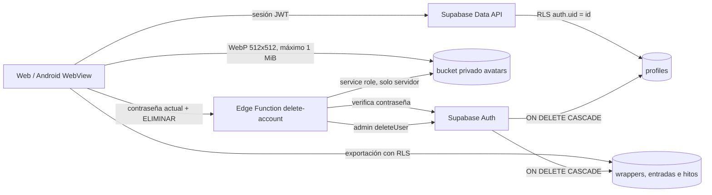

# Sistema privado de perfil de Horizon

## Alcance y fronteras

El perfil es privado y pertenece a una sola cuenta. Contiene nombre visible, descripción, referencia del avatar e inicio del ciclo de 365 días. No existen perfiles públicos, seguidores ni datos sociales.

Supabase Auth conserva correo, contraseña, sesiones y verificaciones. `public.profiles` no duplica credenciales. Las preferencias que deben viajar entre dispositivos viven en `profiles`; los borradores sin guardar continúan en almacenamiento local, separados por usuario.

## Decisión arquitectónica (ADR-001)

**Decisión:** usar una tabla privada `public.profiles` relacionada uno a uno con `auth.users`, un bucket privado `avatars` con una ruta canónica por usuario y una Edge Function autenticada para eliminar la cuenta.

**Motivo:** `user_metadata` forma parte del token y no ofrece un modelo adecuado para preferencias, validación relacional ni RLS. Una tabla permite políticas explícitas y actualizaciones sin renovar el JWT. El bucket privado evita URL públicas permanentes. La eliminación requiere privilegios administrativos que nunca deben llegar al navegador o APK.

**Consecuencias:** el backend debe desplegarse antes que el cliente; el avatar se descarga como objeto autenticado; las cuentas existentes reciben su fila mediante backfill; borrar `auth.users` elimina los datos relacionales por cascada, pero el objeto de Storage se elimina primero desde la función.

## Flujo de datos

## Contrato de datos

`profiles.id` es clave primaria y referencia `auth.users(id) ON DELETE CASCADE`. El nombre admite 1–60 caracteres o `NULL`; la descripción, hasta 160; `avatar_path` solo puede ser `<user-id>/avatar.webp`; `avatar_version` es no negativa; `cycle_start_date` es una fecha. La clave primaria cubre el único patrón de consulta, por lo que no hace falta otro índice.

El trigger de alta crea el perfil. La migración rellena cuentas existentes de forma idempotente. El bucket solo acepta `image/webp` y 1 MiB. El cliente acepta JPEG, PNG o WebP de hasta 10 MiB, corrige orientación, recorta a 512 × 512, recodifica a WebP y elimina metadatos EXIF al rasterizar.

## Seguridad y operaciones sensibles

Las políticas se separan por `SELECT`, `INSERT`, `UPDATE` y `DELETE`. Un usuario no recibe permiso para eliminar directamente su fila. Storage exige bucket, propietario y ruta canónica. Las pruebas en `tests/profile-rls.sql` comprueban acceso negativo entre dos UUID distintos.

El correo se cambia mediante Auth y requiere confirmación por correo. La contraseña actual se revalida antes de guardar una nueva contraseña de ocho caracteres o más. La eliminación exige contraseña actual y la frase `ELIMINAR`; la service role solo existe en la Edge Function. La función no registra correo, contraseña ni contenido personal.

## Exportación y eliminación

La exportación consulta únicamente filas visibles por la sesión, crea JSON para todas las entidades, Markdown para las entradas, añade el avatar si existe y genera un manifiesto con SHA-256. En Android usa la hoja de compartir cuando está disponible; en web descarga un ZIP.

La eliminación borra primero el avatar y después `auth.users`. Las relaciones actuales eliminan perfiles, wrappers, entradas e hitos por cascada. Si la operación falla antes de borrar el usuario, la cuenta permanece y puede reintentarse.

## Experiencia y accesibilidad

El perfil se abre desde el avatar superior y no añade una sexta opción al navbar móvil. Los controles táctiles miden al menos 44 px. El selector de archivos del sistema evita permisos de cámara o almacenamiento en Android. Los formularios conservan su contenido ante un error, avisan cuando no hay conexión y protegen cambios sin guardar al salir. Estados de carga, éxito, error y reintento usan texto además de color.

## Observabilidad privada

Los indicadores operativos recomendados son conteos agregados de éxitos y fallos por operación, latencia p50/p95, errores de Storage por código, exportaciones iniciadas/completadas y eliminaciones iniciadas/completadas. No deben registrar correo, nombre, descripción, contenido, ruta completa, contraseña, token ni UUID sin anonimización irreversible. Los logs de la Edge Function incluidos en esta implementación solo devuelven categorías de error.

## Validación y criterios de aceptación

- Una cuenta existente obtiene un perfil sin perder datos.
- Dos usuarios no pueden leer, cambiar ni borrar el perfil o avatar del otro.
- Cambiar nombre, descripción o fecha aparece tras recargar en web y Android.
- Un avatar se comprime a WebP de 512 × 512 y menos de 1 MiB; sustituirlo no acumula objetos.
- Un fallo de red conserva los campos y permite reintentar.
- Correo y contraseña se gestionan por separado del perfil.
- La exportación contiene todas las entidades y checksums válidos.
- Eliminar la cuenta exige reautenticación y retira datos relacionales y avatar.
- La interfaz funciona a 360 px, 768 px y escritorio, con teclado y foco visibles.

## Secuencia de entrega en seis fases

1. **Base:** inventario, contrato, migraciones y compatibilidad con cuentas existentes.
2. **Seguridad:** RLS de tabla y Storage, bucket privado y pruebas negativas.
3. **Identidad:** pantalla responsive, nombre, descripción, avatar y estados resilientes.
4. **Preferencias y acceso:** ciclo sincronizado, correo, contraseña y cierre de sesión.
5. **Portabilidad:** exportación local y eliminación administrativa reautenticada.
6. **Release:** pruebas, revisión responsive, migraciones remotas, función, web y APK en ese orden.

El rollback operativo está en `supabase/ROLLBACK_PROFILE.md`. Las migraciones y la Edge Function no deben publicarse después del frontend: hacerlo en ese orden dejaría la nueva interfaz apuntando a recursos inexistentes.
