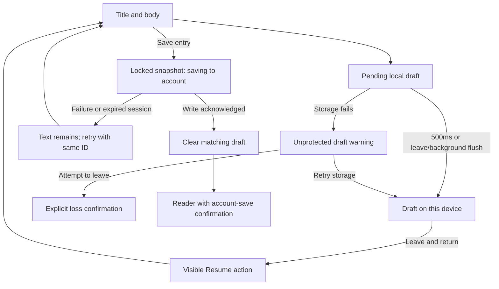

# Horizon: essential journeys — UX recomposition

Status: evaluation complete; publication authorized by the user for v0.1.7. Baseline: d37d6b3 (v0.1.6). Only synthetic records were used for evaluation. No participants have been recruited; walkthroughs are engineering inspections, not user research. Release verification covers the deployed web bundle and signed APK, separately from the outstanding native-device and usability checks below.

## Acceptance criteria defined before implementation

1. With an existing wrapper, desktop and mobile expose a direct writing action. An empty account explains the wrapper prerequisite; completing it continues into writing instead of requiring the user to discover the next step.
2. At 360×800, the title and beginning of the writing area are visible without scrolling through optional metadata. The same controls remain usable at 320px, 768px and desktop widths; long content does not expand the viewport horizontally.
3. The editor explicitly distinguishes unsaved changes, a draft stored only on this device, unavailable local storage, an in-progress account save, and a confirmed account save. It never shows a successful-save icon for a failed write.
4. A new draft and edits to two separate entries survive leaving and reopening on the same device, remain scoped to their owner and entry, and are discoverable from the journal. Successful saving clears only the corresponding draft. Failed saving retains text and permits retry with the same entry identity.
5. An interrupted connection or session does not redirect a failed save away from the text. If device storage is unavailable, attempts to leave warn of potential loss. Edits are locked during a pending save so the submitted snapshot cannot silently discard later typing.
6. Journal search has a persistent accessible label, a result count and a distinct no-results state with a reset action. Search and wrapper context survive reading and returning during the current app session. Entry reading works with keyboard navigation.
7. Reading makes editing the primary action; deletion is secondary, confirmed, and remains on the entry if deletion fails. A successful save opens the saved entry with explicit confirmation.
8. Main task controls have at least 48px touch targets, visible keyboard focus and accessible names. The editor allows Tab to leave the text area; formatting does not require a pointer. Reduced motion is respected.
9. Web and Android share the same components. Safe-area and keyboard handling receive source inspection and browser simulation; native behavior is only called verified if an actual device or emulator is available.
10. The preview is development-only, uses a dedicated synthetic owner, makes no Supabase calls and is absent from the production build. No personal records, credentials or authentication bypass are added to the app.

## Evidence and method

The baseline was exercised on the running Vite application through `ux-preview.html`, importing the real Dashboard, Navbar, BottomNav, BlogEditorPage, BlogJournal, BlogEntryViewPage and ThemeModal with synthetic props. The harness replaces only account transport with deterministic in-memory callbacks; it is not an authenticated Supabase end-to-end test. Source inspection covers App's account boundary, hash navigation, write/read services, account-scoped draft storage, ProfilePage, keyboard hook, Android back hook and MainActivity's system-inset bridge.

Methods: cognitive walkthrough of three tasks, state-transition inspection, keyboard traversal, measured DOM geometry, responsive inspection, fault injection, automated axe checks, regression tests of the actual TypeScript modules. No user completion times, frequency estimates, satisfaction scores or research participants are invented. Severity refers to consequence if encountered; prevalence in real usage is unknown.

### Prioritized diagnosis

| ID | Evidence and reproducible trigger | Consequence / cause | Priority, confidence | Small coherent remedy |
| --- | --- | --- | --- | --- |
| F1 | Observed baseline at 360×800: opening a fresh editor places title at y≈954 and writing at y≈1119, before typing. Three wrapper presentations, goals/priority, date, tags, summary and a large toolbar precede the task. | Writing begins below the viewport. Optional organization competes with composition. | High, directly observed; affects each fresh editor at this size. | One wrapper selector, title/body first, optional metadata disclosure, smaller format group. |
| F2 | Observed green check on an empty draft; source uses the same badge for local storage failure text. Account save performs an upsert followed by a separate list read before reporting success. IDs for new entries are generated inside each save attempt. | Local protection can be mistaken for account persistence. A successful write followed by failed read looks like failure; retry can create a second entry. Typing remains enabled during save. | High, high confidence from source; network-dependent frequency unknown. | Explicit local/account states; stable identity in the draft; treat write confirmation as the boundary; lock the submitted snapshot until the result. |
| F3 | Source saves edit drafts per entry but the journal only reads the single new-entry draft. Navigation offers no visible way to find those edits. Tab in the editor is intercepted to insert spaces. | Existing-entry work becomes difficult to resume; keyboard users cannot Tab out of the body. | High, high confidence; reproduced revised recovery with two separate edits. | Shared pending-draft list on home/journal; normal Tab behavior; synchronous flush and a loss warning when local protection fails. |
| F4 | Observed searching `inexistente` in an account with two entries: empty-state copy invites a first entry. Search field has no accessible label; source renders reading surfaces as click-only articles. Journal-local query disappears on unmount. | Search failure is confused with an empty account; keyboard reading and returning to results are unreliable. | Medium/high, directly observed plus source. | Labeled search + wrapper select + count; separate empty/no-results copy; real reading buttons; lift query to App and restore reading context. |
| F5 | Source: mobile's center action opens a creation chooser; an empty account must create a wrapper and then invoke writing again. Dashboard places recent entries after wrapper cards and statistics. | Extra decision and lost continuation at the first-use boundary; existing work is far from the main action. | Medium, high confidence from source and baseline geometry; perceived burden remains a user-testing hypothesis. | Center action writes directly; first wrapper creation continues into editor; recent work precedes wrapper management. |
| F6 | Reader source gives share/edit/delete equal prominence, reports clipboard success without awaiting it, and returns immediately after starting asynchronous deletion. Raw Markdown HTML is directly injected. | A destructive action competes with continuation; failures hide the entry or misreport success; pasted HTML can execute unsafe behavior. | High for correctness, medium for hierarchy; source-confirmed. | Primary edit, private-link/delete under More, awaited operations with inline failure, sanitize rendered Markdown. |

Automated accessibility inspection additionally exposed visible/accessibility-name mismatches in the motivational home button and wrapper buttons. Motivational text is now decorative and unfocusable; existing Inicio navigation remains the home action. Wrapper actions use names consistent with their visible label. These are correctness fixes, not evidence of a measured usability uplift.

## Recomposition and boundaries

Retain the warm canvas, green primary action, restrained wrapper accents, existing typography, account privacy and “Todo empieza contigo.” Compress the hero rather than replacing its identity. The authenticated home prioritizes writing, pending drafts and recent entries; wrappers and overview remain available below. On narrow screens, calendar/perspective side panels are omitted from home and remain reachable through Calendario.

The editor is a continuous page: back/status/save → one wrapper selector and view controls → format tools → title/body → word count/privacy → optional details. Date defaults to today; summary and tags remain optional. First-wrapper creation similarly keeps name/purpose visible and puts color, priority and goals in an optional disclosure. Markdown remains the source format; split mode remains on desktop and switches back to writing when the viewport narrows. No rich-text engine, new content model, offline database, social feature or new backend schema is introduced.

Journal rows emphasize title, date, wrapper and a brief excerpt. Each has a keyboard-operable reading surface and a separate 48px edit action. Search and wrapper filters operate together and can be reset. Deletion is available from the reader's secondary options, with confirmation and awaited completion. Private link wording no longer suggests public sharing.

### Interaction rules

- One visually dominant action per task region: write on home/journal; save in editor; edit in reader.
- Comfortable reading width, body text around 17px, consistent 48px task controls, 12–24px spacing and subdued borders. Wrapper identity uses text plus color, never color alone.
- Keep optional metadata out of the initial composition path. Disclosures are native, keyboard-operable details/summary elements.
- Local draft status is quiet and explicit. Only connection changes, save confirmations and errors announce themselves; per-keystroke draft updates do not use live regions.
- Show real pending/error feedback. No optimistic success check, navigation after failed save or failed deletion, or raw backend error content in the editor.
- Format buttons preserve the text selection on pointer use; keyboard shortcuts remain available. Tab leaves the writing field normally.
- The mobile save action sits immediately above the real bottom inset, without reserving space for the absent bottom navbar. Content has clearance beneath the action. Native keyboard behavior uses the existing Capacitor integration.
- Route changes move keyboard focus into main content; returning from a reader restores the journal row when available. Search/filter values persist for the current app session, not as a new private-data cache.

### Consequences and deliberate limits

Local drafts are device-only and owner/entry-scoped. They survive ordinary page interruption but are not an encrypted backup and do not synchronize across devices. A cold start without connectivity still cannot load an account's cloud journal. A browser/process crash before the 500ms debounce or lifecycle flush can lose the most recent keystrokes. Simultaneous editing of one draft in multiple tabs is not conflict-resolved. These are explicit limits, not promises of complete offline support.

The write acknowledgement updates App's in-memory account list without requiring a second network read. Server-owned transformations or future concurrency rules would require revisiting that boundary. A retry reuses the same entry ID; discarding a new draft starts a new identity. Clearing a draft only follows a confirmed write; stale edit drafts older than the account entry are excluded from recovery.

DOMPurify sanitizes rendered Markdown in both preview and reading, allowing normal HTML formatting while removing dangerous content. This introduces one production dependency; axe is development-only. See [DOMPurify's documentation](https://github.com/cure53/DOMPurify). Touch sizes here are a product choice above the [WCAG 2.2 minimum-target criterion](https://www.w3.org/WAI/WCAG22/Understanding/target-size-minimum.html), not a claim of complete accessibility certification.

## Before / after journey maps

### 1. Enter and start

Before: home → large hero / counts / wrapper cards → choose write; mobile center → choose entry vs wrapper → editor. Empty account → wrapper form → home → discover writing again.

After: home → Write → editor. Mobile center → same editor. Empty account → explanatory wrapper prerequisite → create wrapper → editor with that wrapper selected. Returning users see unfinished writing and recent entries before wrapper administration.

### 2. Compose, save, leave, resume

Before: editor → wrapper banner + duplicate wrapper chip/select + metadata → summary → body → ambiguous draft badge → Save → network write → network list refresh → journal. Edit draft recovery exists only if the original entry is reopened manually.

After:

Save errors leave the editor usable. A lost/expired session may still return the application to sign-in through its existing auth listener; the old owner's draft is flushed and can be resumed after that same owner signs in. Cross-account data continues to be cleared by the existing session epoch boundary.

### 3. Find, read, edit

Before: journal → horizontally wrapping filter chips → unlabeled search → clickable card → reader with three competing actions → edit → save → journal with lost query.

After: journal → labeled search + wrapper select → result count or resettable no-results → keyboard-operable reading row → primary Edit → save → confirmed reader → return to retained query/filter and reading position.

## Small implementation phases and rollback

| Phase | Change / dependency | Validation and risk |
| --- | --- | --- |
| 1 | Establish synthetic baseline and acceptance criteria. No backend dependency. | Reproduce first-write and search problems; protect personal data. |
| 2 | Centralize draft lifecycle, stable identity, route flush/loss guard; keep owner/entry isolation. Depends on 1. | Regression tests and interrupted editing; highest risk is draft loss or resurrection. |
| 3 | Recompose editor hierarchy and save states; sanitize rendered content. Depends on 2. | Fresh/recovered/error/pending layouts, keyboard traversal and long text. |
| 4 | Recompose journal/search/reader; lift search to App, await reader operations, open confirmed save. Depends on 2–3. | Find → read → back; edit → failed save → retry; delete failure. |
| 5 | Compact home, prioritize recent/draft work, direct mobile writing and continue after first wrapper. Depends on 3–4. | Empty and populated synthetic account walkthroughs. |
| 6 | Responsive/accessibility/failure review; document evidence and publish the authorized release. Depends on 1–5. | Build/test/lint, production artifact exclusion, axe, web deployment and signed-APK verification. Manual Android/user checks remain outstanding. |

No SQL or data migration is required. Rollback consists of reverting this frontend change set; existing v2 account-scoped drafts remain readable because new identity fields are optional. Keep user drafts during rollback. Remove the preview HTML/module and its development dependency if review tooling is no longer needed. Do not touch the unrelated untracked `core/` folder.

## Reproducing the review

Start the existing Vite dev server and open `/ux-preview.html`. Direct review links accept `?view=editor`, `?view=blog`, `?view=entry&scenario=long` and `?scenario=empty`. Adding `&audit=1` runs axe on the rendered view. The review controls select a populated/empty/long-entry scenario, normal/slow/failing/expired save, or a synthetic quota error. Quota interception applies only to the `ux-synthetic-review` owner. Android CSS classes and 24px top / 48px bottom insets can be simulated; these controls do not emulate a native WebView or IME. An axe button audits the current app view; the review controls themselves are excluded.

Scenario changes/reloads reset the sample account records. Drafts deliberately survive under the synthetic owner; this is necessary for recovery testing. Sensitive account actions are not functional in the harness. No real login, password, Supabase call or deployment is needed to review it.

Tasks for an independent reviewer:

1. In an empty account, create a wrapper from Write. Verify the next screen is the editor with the new wrapper selected.
2. In a populated account at 360×800, open Write. Locate title/body and account-save action before scrolling. Expand Details only when needed.
3. Type a new draft, leave, return using Resume. Edit each sample entry, leave, and reopen both independently. Verify the exact texts.
4. Simulate failed save, verify text remains, then restore normal save and retry. Confirm one saved entry, explicit success and no corresponding pending draft.
5. Simulate slow save. Verify title/body are disabled and navigation cannot silently discard changes during the request.
6. Simulate storage full, type, and attempt to leave. Cancel the warning, verify text remains, then restore storage and retry local saving.
7. Search `paseo`, open the matching row with Enter and return. Verify the query/filter persist. Search a nonexistent term and use Reset.
8. Read and edit long Markdown, including a long link, table and code block. Verify wrapping and local horizontal scrolling of wide content.
9. Traverse with Tab/Shift+Tab; test visible focus and Ctrl/⌘+B/I/S. Check 320/360/393/768/1280px widths and both Android navigation modes on a real device.
10. Use a dedicated staging account to verify actual Supabase failures, token expiry/re-login, browser Back and Android back/IME before considering production publication.

For a small usability study, recruit 4–6 people who write personal notes, including Android users unfamiliar with Horizon. Give task goals without naming controls; observe completion without assistance, wrong turns, pauses, save-status understanding and recovery. Compare equivalent tasks/content against the baseline; counterbalance order if people see both versions. Treat results as qualitative signals, not population statistics. No participant recordings or private journal text are necessary for the engineering handoff.

## Validation record

### Observed in the running local prototype

| Check | Result | Boundary of the evidence |
| --- | --- | --- |
| First wrapper → write | Passed: created `Mi cuaderno de prueba`; editor opened with that wrapper selected. | Real components, synthetic transport. |
| New draft → leave → Resume | Passed: title and multiline text restored. | Same browser/device, synthetic owner. |
| Two separate edited entries | Passed: both pending edits appeared and reopening A retained A's text independently of B. | Also covered by account/entry isolation regression tests. |
| Failed account save → retry | Passed: failure left text editable; normal retry opened the saved reader and showed explicit confirmation. | Deterministic callback failure, not a live Supabase network fault. |
| Slow account save | Passed: 3.5s request showed pending account status, disabled body/title, and prevented profile navigation. | Real editor/guard; synthetic callback. |
| Expired save session | Passed: simulated rejection retained exact text and editing controls. | Actual token-expiry/auth-listener transitions still need staging verification. |
| Local quota failure → storage retry | Passed: `Borrador sin proteger`, visible warning and unchanged text; restoring storage and Retry removed warning and confirmed local draft. | Interceptor targets synthetic owner only. |
| Unsafe exit confirmation | Loss-confirmation boundary was reached; the browser automation was blocked by its native confirm dialog. User dismissed it. | Native dialog cancellation was not independently completed by automation; event cancellation is unit-tested. |
| Search → Enter on reading row → return | Passed: `paseo` yielded the matching entry and survived return; no-results state offered Reset and correctly returned existing entries. | Prototype parent state mirrors App's lifted query; live authenticated App history remains a staging check. |
| Tab from body | Passed: focus reached Details instead of inserting spaces or becoming trapped. | Chromium browser keyboard test. |
| Desktop split → mobile resize | Passed: writer remained available and returned to write mode. | Browser viewport emulation. |
| Pasted HTML/Markdown | Passed: bold text remained; iframe, style, event handler and javascript-link attributes were absent from rendered DOM. | Harmless synthetic payload; not a complete security audit. |
| Android inset/keyboard-class simulation | Passed at 360×440: 24px top and 48px bottom inputs produced save-bar bottom at y=392 with no horizontal overflow. | CSS simulation only. Android bridge/back/IME integration is source-reviewed; no connected device/emulator. |

Geometry measured at zero scroll with review controls collapsed (the local review header adds its own small height):

| Viewport width × height | Title document y | Body document y | Document width / available width | Save bar height |
| --- | ---: | ---: | ---: | ---: |
| 320 × 800 | 408 | 474 | 305 / 305 | 76 |
| 360 × 800 | 408 | 474 | 345 / 345 | 76 |
| 393 × 800 | 408 | 474 | 378 / 378 | 76 |
| 768 × 800 | 408 | 474 | 753 / 753 | 76 |
| 1280 × 800 | 382 | 452 | 1265 / 1265 | Desktop action |

Baseline at 360×800 was title y≈954, body y≈1119. The review header changed slightly during implementation, so these measurements establish first-viewport visibility rather than a controlled task-time comparison. Revised writing starts above the fixed save bar; optional metadata no longer precedes it. The 15px difference between viewport and available width is the browser scrollbar, not overflow.

A long-entry fixture repeats the sample 70 times and adds a very long URL, table cell and code line. At 320/360/393/768/1280px, document width matched available width; table and code containers stayed within the reading column (235/263/296/663/746px respectively). This verifies containment, not a native performance benchmark.

### Accessibility

Final axe checks used WCAG 2 A/AA, 2.1 A/AA and 2.2 AA tags. Results for populated synthetic views:

| View | 360px violations | 1280px violations | Automated checks requiring manual follow-up |
| --- | ---: | ---: | --- |
| Home | 0 | 0 | Some color-contrast checks could not resolve layered/background presentation. |
| Journal | 0 | 0 | Some mobile color-contrast checks remained incomplete. |
| Reader | 0 | 0 | Some mobile color-contrast checks remained incomplete. |
| Editor | 0 | 0 | None in the tested initial state. |

Visible-label mismatches, inappropriate generic-element ARIA labels and low-contrast sidebar captions found during inspection were corrected. Rotating motivational text no longer fades through low-opacity intermediate states or becomes a navigation control. Reduced-motion preference still disables its timed rotation. Automated checks do not prove screen-reader usability, enlarged-text support or full WCAG conformance.

### Engineering checks and release boundary

- TypeScript/Vite production build passed.
- 19 Node regression tests passed, including the new draft discovery, empty-edit recovery, stable identity and cancelable navigation-boundary cases. To see each case independently: `node --test --test-isolation=none --test-reporter=spec tests/privacy-regression.test.mjs`.
- Lint completed; pre-existing App/ThemeModal/Calendar/Fast Refresh warnings are documented by the tool output. No new warning should be accepted in the final recomposition files.
- `npm run test:preview-boundary` checks the built output: no preview HTML, synthetic owner/record markers, axe tool or lab CSS may ship.
- `npm run cap:sync` updates local Android web assets. It does not verify a native APK or install it.
- Production dependency audit found zero reported vulnerabilities. Development-tool advisories are outside this UX change and were not force-upgraded.
- The initial evaluation ended with local changes only. Following the user's request to publish, version 0.1.7 is prepared for GitHub and Vercel. No Supabase migration is required. The release must be verified against its actual commit and downloadable APK before reporting publication complete.

### Remaining validation for broader rollout

1. Test on a real Android device/emulator: gesture and button navigation, keyboard open/close, hardware back first dismissing IME, landscape and WebView layout. `adb devices` returned no attached devices during this review.
2. Use staging accounts for actual session expiry/re-login, interrupted HTTP responses, browser Back/Forward, focus restoration, and failed reader deletion. The service tests verify rejected operations; the native deletion-confirmation flow was source-reviewed rather than exercised on real records.
3. Manually review axe's unresolved contrast checks and run TalkBack/screen-reader and enlarged-text testing. Do not equate zero automated violations with certification.
4. Run the small independent usability study described above before claiming improved task success, confidence, or reduced hesitation. Those are expected improvements awaiting human evidence.

The recomposition and its review tooling are complete. The user authorized publication after the engineering review; native/live-service and representative-user validation remain outstanding and are not represented as passed by a successful release build.
